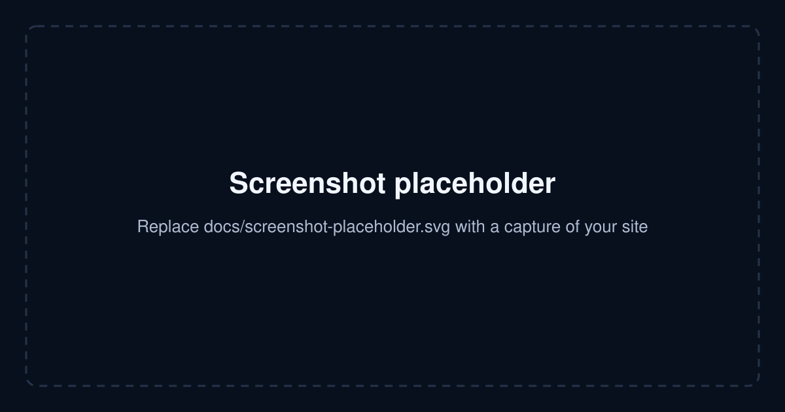
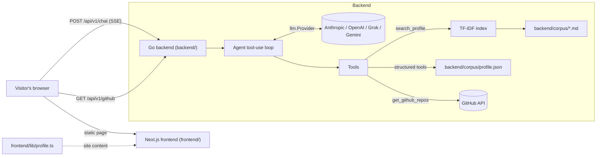

# Portfolio RAG Template

**A portfolio site with an AI agent that answers questions about you.**

Recruiters and engineers ask the agent things like *"Has she worked with Kubernetes?"* or *"Is he a fit for a Staff backend role?"*. A Go backend retrieves passages from your own documents (RAG), calls structured tools (projects, skills, contact links, live GitHub repos), and streams a grounded answer — with the tool calls and retrieved sources shown live in the console.

> **Use this template:** click **Use this template → Create a new repository** on GitHub (repo owners: tick *Settings → General → Template repository* to enable the button), then follow [Make it yours](#make-it-yours).



<!-- Replace docs/screenshot-placeholder.svg with a real screenshot of your deployed site. -->

## Features

- **AI agent grounded in your documents** — TF-IDF retrieval over a folder of Markdown files; the agent is instructed never to invent facts.
- **Tool-use loop (MCP-style)** — `search_profile`, `get_experience_summary`, `get_skills`, `list_projects`, `get_links`, `get_github_repos`.
- **Live streaming UI** — Server-Sent Events show each tool call, the retrieved source IDs, then the answer.
- **Swap LLM providers with one env var** — Anthropic Claude, OpenAI, xAI Grok, or Google Gemini (`LLM_PROVIDER`). API keys never reach the browser.
- **One file for all site content** — `frontend/lib/profile.ts` drives the page, SEO metadata, JSON-LD (`Person`, `FAQPage`), Open Graph image, `robots.txt`, `sitemap.xml` and `llms.txt`.
- **Zero external services required** — no database; the corpus is plain files. Optional Google Analytics.
- **Docker Compose** for a one-command local stack, plus CI for Go vet/test and Next.js lint/build.

## Architecture



How a question is answered:

1. The browser sends the chat history to `POST /api/v1/chat`.
2. The agent sends it to the LLM together with the tool definitions.
3. When the model calls a tool, the backend runs it (e.g. ranks corpus chunks for `search_profile`), streams `tool` and `sources` events, and feeds the result back to the model.
4. The loop repeats (up to 5 steps) until the model answers; `text` events stream the answer and `done` closes the stream.

```
.
├── backend/                 Go API (no third-party dependencies)
│   ├── cmd/server/          Entry point; picks the LLM provider from LLM_PROVIDER
│   ├── corpus/              ← YOUR knowledge base: profile.json + *.md (see corpus/README.md)
│   └── internal/
│       ├── agent/           Tool-use loop + system prompt
│       ├── kb/              Corpus loader + TF-IDF retrieval
│       ├── profile/         profile.json loader
│       ├── tools/           Tool registry and executor
│       ├── github/          Cached GitHub repo fetcher
│       ├── llm/             Provider interface + Anthropic, OpenAI, Grok, Gemini
│       └── server/          HTTP routes, SSE, CORS
├── frontend/                Next.js 16 (App Router, TypeScript)
│   ├── lib/profile.ts       ← YOUR site content (single config file)
│   ├── components/          Agent console, GitHub strip, page sections
│   └── app/                 Page, layout, OG image, robots, sitemap, llms.txt
├── docker-compose.yml
└── .github/workflows/ci.yml
```

## Quickstart

**Prerequisites:** an API key for one LLM provider, plus either Docker, or Go 1.26+ and Node 20+.

### Option A — Docker Compose

```bash
cp backend/.env.example backend/.env   # set LLM_PROVIDER and its API key
docker compose up --build
```

Open http://localhost:3000. Backend health: http://localhost:8080/api/v1/health.

### Option B — run backend and frontend directly

```bash
# Terminal 1 — backend on :8080
cd backend
cp .env.example .env          # set LLM_PROVIDER and its API key
go run ./cmd/server

# Terminal 2 — frontend on :3000
cd frontend
cp .env.example .env.local
npm ci
npm run dev
```

The site renders without the backend; the agent console and GitHub strip show a friendly "backend not reachable" message until it is running.

### Configuration

Backend (`backend/.env`, see [`backend/.env.example`](backend/.env.example)):

| Variable | Default | Purpose |
| --- | --- | --- |
| `LLM_PROVIDER` | `anthropic` | `anthropic`, `openai`, `grok` or `gemini` |
| `ANTHROPIC_API_KEY` / `ANTHROPIC_MODEL` | — / `claude-sonnet-4-6` | Anthropic credentials and model |
| `OPENAI_API_KEY` / `OPENAI_MODEL` | — / `gpt-4o` | OpenAI credentials and model |
| `XAI_API_KEY` / `GROK_MODEL` | — / `grok-3` | xAI credentials and model |
| `GEMINI_API_KEY` / `GEMINI_MODEL` | — / `gemini-2.0-flash` | Google credentials and model |
| `CORPUS_DIR` | `corpus` | Folder with `profile.json` and documents |
| `GITHUB_USER` | — | GitHub username for the repo strip and `get_github_repos` |
| `GITHUB_TOKEN` | — | Optional; raises the GitHub API rate limit |
| `ALLOWED_ORIGIN` | `*` | Comma-separated CORS origins (set to your site URL in production) |
| `PORT` | `8080` | HTTP listen port |

Frontend (`frontend/.env.local`, see [`frontend/.env.example`](frontend/.env.example)) — all inlined at build time:

| Variable | Default | Purpose |
| --- | --- | --- |
| `NEXT_PUBLIC_API_BASE` | `http://localhost:8080` | Backend URL the browser calls |
| `NEXT_PUBLIC_SITE_URL` | `SITE.url` in `profile.ts` | Canonical site URL |
| `NEXT_PUBLIC_GA_ID` | — | Google Analytics 4 ID; analytics are off when empty |

## Make it yours

1. **Create your repo** from this template (see the note at the top) and clone it.
2. **Edit the site content** in [`frontend/lib/profile.ts`](frontend/lib/profile.ts) — name, URL, hero copy, about, experience, projects, FAQ, suggested questions, links. Everything marked as placeholder ("Alex Doe", `example.com`, `your-username`) is in this one file.
3. **Give the agent its knowledge** in [`backend/corpus/`](backend/corpus/README.md):
   - update `profile.json` (name, headline, links, skills, projects, roles);
   - replace the sample `*.md` files with your own — bio, résumé sections, project write-ups, talks, FAQs. Each `## Heading` section becomes one retrievable chunk.
4. **Set your keys** in `backend/.env`: `LLM_PROVIDER` plus that provider's API key, and `GITHUB_USER` for the live repo strip.
5. *(Optional)* Add a résumé to `frontend/public/` and set `SITE.resumeUrl` (e.g. `"/resume.pdf"`), replace `frontend/app/icon.svg`, tweak colours in `frontend/app/globals.css`, and adjust the agent's voice in `backend/internal/agent/agent.go` (`SystemPrompt`).
6. Replace `docs/screenshot-placeholder.svg` with a screenshot and update this README.

Then search the repo for `Alex`, `example.com` and `your-username` to make sure nothing placeholder is left.

## Deployment

The two halves deploy independently:

- **Backend** — a single static Go binary with no database. Build the `backend/Dockerfile` image and run it on any container host (Fly.io, Render, Railway, Google Cloud Run, AWS App Runner/ECS, a VPS). Provide the env vars from the table above as secrets, set `ALLOWED_ORIGIN` to your site URL, and make sure the corpus is in the image (it is copied by default) or mounted at `CORPUS_DIR`. The chat endpoint streams SSE, so disable response buffering on any proxy in front of it.
- **Frontend** — a standard Next.js app (`output: "standalone"`). Deploy to Vercel, Netlify, AWS Amplify, or the `frontend/Dockerfile` image. Set `NEXT_PUBLIC_API_BASE` to the public backend URL and `NEXT_PUBLIC_SITE_URL` to your domain **at build time**.
- **Costs and abuse** — every chat message calls a paid LLM API. Consider a spending cap on your provider account and rate limiting at your proxy or host.

CI ([`.github/workflows/ci.yml`](.github/workflows/ci.yml)) runs `go vet`, `go test`, `npm run lint` and `npm run build` on every push and pull request. Add your own deploy workflow for your host.

## Customising further

- **Add a tool** — add a definition to `Definitions` and a case to `Execute` in `backend/internal/tools/tools.go`.
- **Add an LLM provider** — implement `llm.Provider` (`Complete`, `ModelName`) in `backend/internal/llm/<name>` and add it to `newProvider` in `backend/cmd/server/main.go`.
- **Better retrieval** — `internal/kb` is a dependency-free TF-IDF ranker; swap `Index.Retrieve` for embeddings or a vector store if your corpus grows large.

## License

[MIT](LICENSE)

---

<sub>Built by [Neeraj Singhi](https://github.com/neerajsinghi).</sub>
